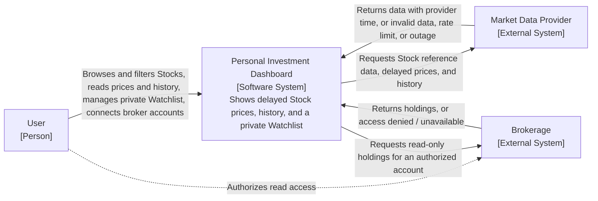
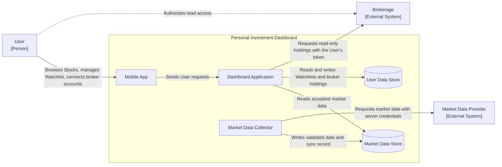
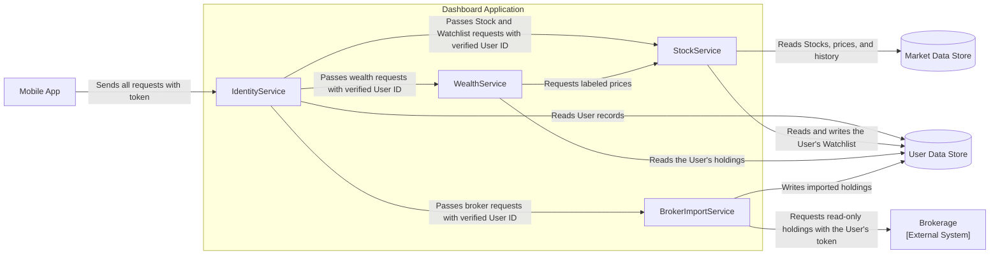
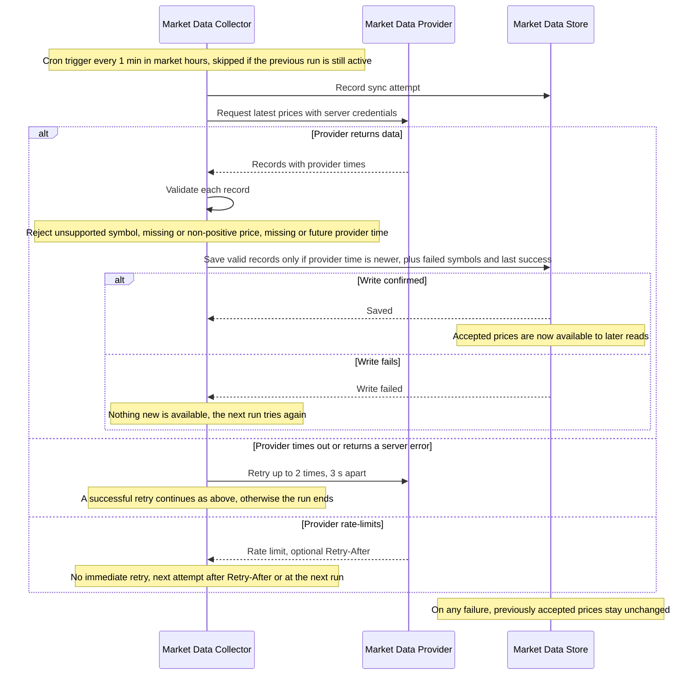
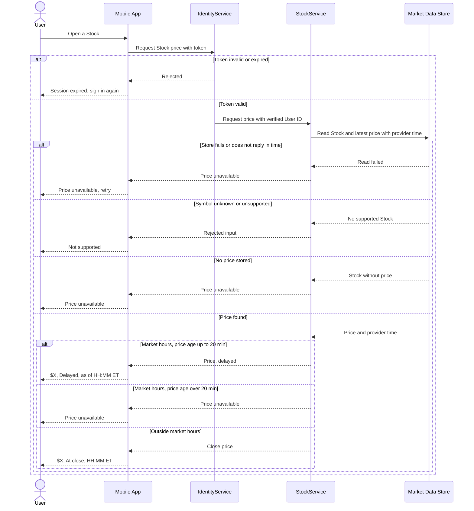
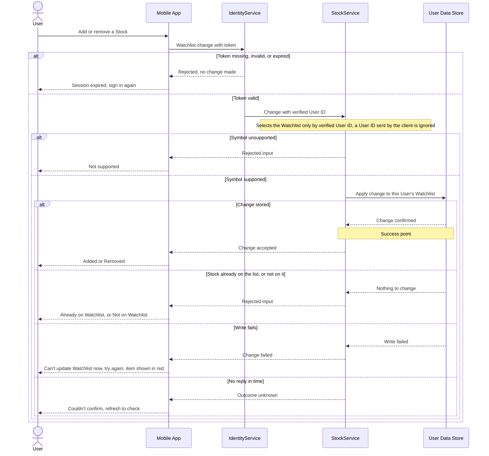

# Lab 3: Personal Investment Dashboard - Baseline Architecture

Scope: the Lab 3 given behavior (browse and filter Stocks, read prices and history, manage a private Watchlist) with the Lab 2 load targets. The Brokerage from Lab 1 stays in the views; none of the three flows uses it.

---

## 1. System Context diagram

---

## 2. Container diagram

| Container | Responsibility |
| --------- | -------------- |
| Mobile App | Shows Stocks, prices, history, and the Watchlist to the User |
| Dashboard Application | Answers every User request from stored data |
| Market Data Collector | Syncs market data from the provider; holds the provider credentials |
| Market Data Store | Keeps accepted market data and the sync record |
| User Data Store | Keeps Users, Watchlists, broker connections, and imported holdings |

**Design choices:** User reads never call the provider. The Stock price read is 6,000 of 7,920 steady RPS, while the provider updates about once per minute, so reads use stored data and do not spend provider quota or inherit provider latency and outages. The Market Data Collector is a separate application so a failing or rate-limited sync cannot stop reads, and read load cannot delay sync. Stores are grouped by related data: public market data written only by the Collector, and private User data written only by the Dashboard Application. The Mobile App calls the Dashboard Application directly; with one client and one backend there is nothing to route.

---

## 3. Component diagram

| Dashboard Application component | Responsibility |
| ------------------------------- | -------------- |
| IdentityService | Verifies the User's token on every request and passes the verified User ID on |
| StockService | Checks Stock requests, reads Stocks, prices, and history, applies the 20-minute freshness rule, and changes the User's own Watchlist |
| WealthService | Calculates holding value as price x quantity, using labeled prices from StockService |
| BrokerImportService | Requests holdings from the Brokerage with the User's token and saves them |

**Access checks:** IdentityService checks identity on every request, not only at sign-in. StockService checks Watchlist ownership before any read or write: it selects the Watchlist only by the verified User ID, and anything else is denied. The Market Data Collector is not shown because it never talks to the Dashboard Application, only to the Market Data Store.

---

## 4. Sequence diagrams

Results return to the Mobile App through IdentityService; the return arrows are drawn directly to keep the diagrams readable.

### A. Sync market data

**Assumptions:**

- The Collector is the only process that syncs, and the supported Stock list is already stored.
- One run requests the latest prices of all supported Stocks; provider paging is not shown.
- Provider credentials stay in the Collector's server environment and never reach the Mobile App.
- Failed symbols are requested again in the next run. When a sync fails, previously accepted prices are kept, and reads label them by Lab 2 CON-1: "Delayed" up to 20 minutes of age, then "Price unavailable."

### B. Read a Stock price

**Assumptions:**

- The User is signed in on the Mobile App, and at least one sync has run.
- A User read needs no new provider request: StockService reads only the Market Data Store.
- Price age = read time - provider time, and market hours are as defined in Lab 2.
- If no result arrives within 2 s, the Mobile App stops waiting and shows "Price unavailable, retry" (Lab 2 LAT-3). The User decides when to retry.

### C. Change a private Watchlist

**Assumptions:**

- Each User has one Watchlist. StockService checks the symbol against the stored Stock list.
- Because the Watchlist is selected only by the verified User ID, a request cannot address another User's Watchlist; an unauthorized attempt is rejected by IdentityService.
- Success is reported only after the User Data Store confirms the change. On a failed write the list stays as last confirmed, and the failed item is shown in semi-transparent red.
- **Next read (Lab 2 CON-2):** after "Added" or "Removed," every later Watchlist read by the same User, from any device, includes the change. If that cannot be guaranteed, the read shows "Watchlist unavailable" instead of the old list.
