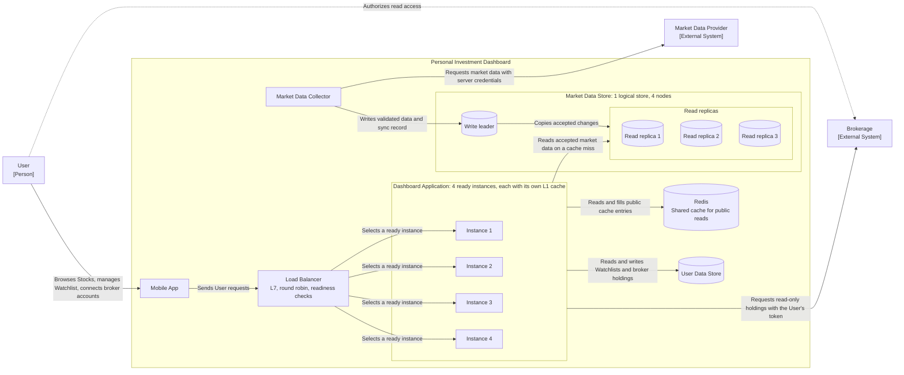
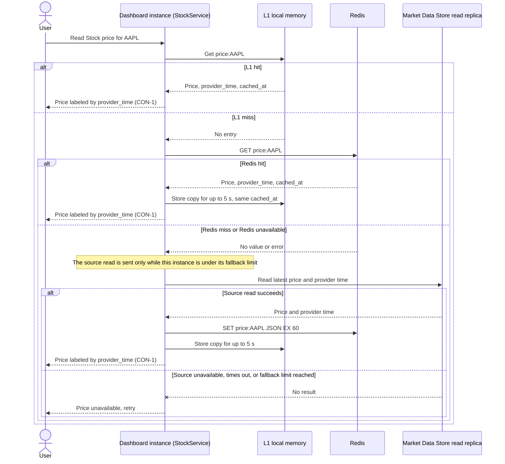
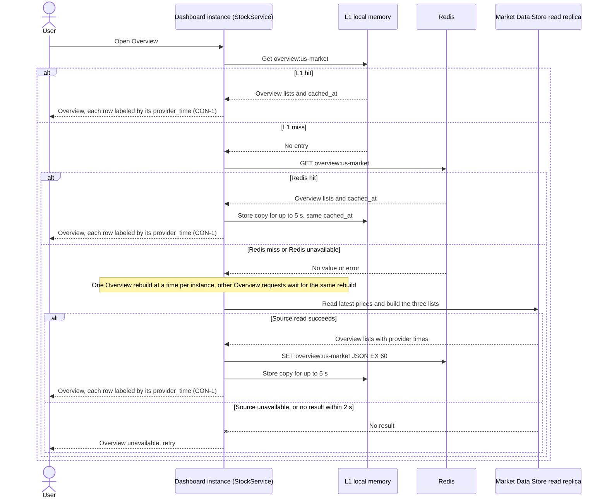

# Lab 4: Personal Investment Dashboard - Read Path Scaling

Scope: the 3,000-User Stock price read path from Lab 2 on the Lab 3 containers. The Lab 2 quality requirements and the Lab 3 flows stay as written; every change to Lab 3 is listed in section 2.

---

## 1. Scale the service and route requests

### Dashboard instances

```text
buffered target = Stock price RPS x (1 + buffer)
                = 600 x 1.20 = 720 RPS

instances for normal load = ceil(720 / 250) = ceil(2.88) = 3

with 3 instances and one loss: 2 x 250 = 500 RPS  (below 720)
with 4 instances and one loss: 3 x 250 = 750 RPS  (meets 720)

minimum = 4 ready Dashboard instances
```

The 250 RPS per instance is valid only for the load-tested resource settings (CPU request 500m, limit 1 CPU; memory request 512Mi, limit 1Gi). No cache hit rate is assumed in this count.

### Load balancer

| Decision | Choice |
| -------- | ------ |
| Layer | L7 (HTTP) |
| Selection method | Round robin over ready instances |
| Reason | Every Mobile App request is an independent HTTP request, and Stock price requests have similar service cost, so equal turns give equal load. L7 spreads single requests even when the Mobile App keeps one connection open, and its readiness check removes a stopped instance from routing. |
| Main limit | Round robin does not see how busy an instance is. A slow instance, or one that is serving heavier Overview and History reads, still receives every fourth request. |

### State and instance loss

| State | Where the state lives | If one Dashboard instance stops |
| ----- | --------------------- | ------------------------------- |
| User records that IdentityService verifies tokens against | User Data Store | Another instance verifies the next request |
| Watchlists, broker connections, imported holdings | User Data Store | Another instance reads the confirmed value |
| Accepted prices, provider times, history, sync record | Market Data Store | Another instance reads the same accepted data |
| Shared public cache entries | Redis (rebuildable, not required) | Another instance reads the same entry |
| Parsed fields and verified User ID of the current request | Instance memory | The in-flight request fails; the Mobile App shows "unavailable, retry" (Lab 2 LAT-3) and the next request reaches another instance |
| L1 cache copies of public reads | Instance memory | Lost; the next read uses Redis or a read replica |

No required state lives only in one instance, so the Dashboard Application is stateless between requests.

---

## 2. Scale the Market Data Store

```text
read replicas for normal load = ceil(720 / 400) = ceil(1.8) = 2

with 2 replicas and one loss: 1 x 400 = 400 RPS  (below 720)
with 3 replicas and one loss: 2 x 400 = 800 RPS  (meets 720)

Market Data Store = 1 write leader + 3 read replicas = 4 nodes
```

The brief requires the one-loss rule only for Dashboard instances. The same rule is applied to the read replicas because of the 99.9% market-hours availability target from Lab 2. The write leader is not counted, and no cache hit rate is assumed.



**Replication:** single leader, asynchronous. The Market Data Collector writes accepted prices to the write leader, and the Collector's "save only if provider time is newer" check also reads the write leader. Public reads use only the read replicas. A lagging read replica can return an older accepted price, but the label still comes from the provider time (Lab 2 CON-1), so an old price is never shown as current. If the write leader stops, reads continue from the read replicas, and prices that pass 20 minutes of age show "Price unavailable." Write-leader failover is not designed in this lab.

**Changes to Lab 3:**

| Lab 3 decision | Lab 4 change |
| -------------- | ------------ |
| The Mobile App calls the Dashboard Application directly ("nothing to route") | The Mobile App calls the Load Balancer, which selects one of 4 ready instances |
| Every public read goes to the Market Data Store | A public read checks L1, then Redis, and reads the Market Data Store only on a miss |
| The Market Data Store is one node | 1 write leader + 3 read replicas; the Collector writes to the write leader |
| No cache container | Redis is added as a shared cache for public reads |

Unchanged: no provider request on a User read, the Flow B result labels, and all Lab 2 targets.

---

## 3. Cache two public reads

**Overview** is the US market overview: the top 10 gainers, top 10 losers, and 10 most active Stocks. Every User gets the same result (assumption; Lab 2 only names the read).

### Cache contracts

| Decision | Stock price | Overview |
| -------- | ----------- | -------- |
| Repeated work removed | 600 RPS ask for the same 11,152 latest prices, which change at most once per minute. A hit removes one read-replica query. | 70 RPS steady plus 90 RPS at market open ask for one identical result. A hit removes a scan and sort over 11,152 latest prices. |
| Key | `price:{symbol}`, for example `price:AAPL` | `overview:us-market` (the only input is the market, and the Dashboard supports one) |
| Value | `symbol`, `price`, `currency`, `provider_time`, `cached_at`. No label is stored: "Delayed," "At close," or "Price unavailable" is calculated at read time. | Three lists of rows with `symbol`, `price`, `change_pct` or `volume`, and `provider_time`, plus one `cached_at` |
| Private User data | None. The key and value hold no User ID, token, or Watchlist. | None |
| Source | Latest prices in the Market Data Store, read from a read replica | Latest prices and Stock reference data in the Market Data Store, read from a read replica |
| L1 lifetime | 5 s, and never past `cached_at` + 60 s | 5 s, and never past `cached_at` + 60 s |
| Freshness | Simple TTL. Fresh while `now - cached_at <= 60 s` (one sync interval). No stale use. Redis expiry: `EX 60`. | Simple TTL. Fresh while `now - cached_at <= 60 s`. No stale use. Redis expiry: `EX 60`. |
| Failure result | L1 entry lost: read Redis. Redis empty or unavailable: read a read replica within the fallback limit, and the User sees the normal result. Read replica unavailable or fallback limit reached: "Price unavailable, retry." An old price is never shown instead. | Same path. Read replica unavailable or fallback limit reached: "Overview unavailable, retry." |

`cached_at` is the time of the source read and moves with the copy into both layers, so an L1 hit cannot extend the age of the data. On every result, in any layer, the Dashboard Application applies Lab 2 CON-1 to `provider_time`: up to 20 minutes "Delayed, as of HH:MM ET," above 20 minutes "Price unavailable," outside market hours "At close." In Overview the rule is applied to each row. The cache adds at most 60 s to the 1-minute sync interval, which stays inside the 5-minute sync slack of CON-1.

### Sequence: Stock price

Assumes a valid token and a supported symbol; those branches are in Lab 3 Flow B.



### Sequence: Overview



### Warmup and fallback

| Rule | Decision |
| ---- | -------- |
| When | 09:29:30 ET on trading days, and after Redis restarts or recovers |
| Bounded keys | `overview:us-market` and `price:{symbol}` for the 500 most-read Stocks of the previous trading day: at most 501 keys (500 is an assumption to replace with measured read counts) |
| How | One batched read-replica query for the 500 prices and one Overview query, written to Redis with `EX 60`. L1 is not pre-warmed; each instance fills L1 on its first read. |
| Fallback limit, Stock price | Each Dashboard instance sends at most 200 source reads per second: 4 x 200 = 800 RPS, which equals 2 read replicas (one lost) and covers the 720 RPS target |
| Fallback limit, Overview | One rebuild at a time per Dashboard instance |

Because the Redis expiry is 60 s, the warmup covers the first minute after market open, which contains the 10-second market-open burst from Lab 2. After that, normal reads refill the keys.

**User result:** a key that the warmup did not reach is an ordinary miss. Under the fallback limit the User sees the normal labeled result from a read replica. When the fallback limit is reached, the User sees "Price unavailable, retry" or "Overview unavailable, retry" and decides when to retry. An old or unlabeled price is never shown.

---

## 4. Redis cache path with commands

Run on a local Redis 8.10.2 server started with no persistence (`--save "" --appendonly no`). The second `GET` and the `TTL` were sent 3 seconds after the `SET`.

### Stock price

Stored JSON value:

```json
{"symbol":"AAPL","price":229.35,"currency":"USD","provider_time":"2026-11-10T15:00:00Z","cached_at":"2026-11-10T15:15:20Z"}
```

```text
127.0.0.1:6379> GET price:AAPL
(nil)
127.0.0.1:6379> SET price:AAPL '{"symbol":"AAPL","price":229.35,"currency":"USD","provider_time":"2026-11-10T15:00:00Z","cached_at":"2026-11-10T15:15:20Z"}' EX 60
OK
127.0.0.1:6379> GET price:AAPL
"{\"symbol\":\"AAPL\",\"price\":229.35,\"currency\":\"USD\",\"provider_time\":\"2026-11-10T15:00:00Z\",\"cached_at\":\"2026-11-10T15:15:20Z\"}"
127.0.0.1:6379> TTL price:AAPL
(integer) 57
```

Between the first `GET` and the `SET`, the Dashboard instance reads the latest price and provider time from a read replica, as in the Stock price sequence.

### Overview

Stored JSON value (one row per list shown; the real value has 10):

```json
{"market":"US","gainers":[{"symbol":"NVDA","price":141.20,"change_pct":4.1,"provider_time":"2026-11-10T15:00:00Z"}],"losers":[{"symbol":"INTC","price":22.40,"change_pct":-3.2,"provider_time":"2026-11-10T15:00:00Z"}],"most_active":[{"symbol":"AAPL","price":229.35,"volume":18400000,"provider_time":"2026-11-10T15:00:00Z"}],"cached_at":"2026-11-10T15:15:21Z"}
```

```text
127.0.0.1:6379> GET overview:us-market
(nil)
127.0.0.1:6379> SET overview:us-market '{"market":"US","gainers":[{"symbol":"NVDA","price":141.20,"change_pct":4.1,"provider_time":"2026-11-10T15:00:00Z"}],"losers":[{"symbol":"INTC","price":22.40,"change_pct":-3.2,"provider_time":"2026-11-10T15:00:00Z"}],"most_active":[{"symbol":"AAPL","price":229.35,"volume":18400000,"provider_time":"2026-11-10T15:00:00Z"}],"cached_at":"2026-11-10T15:15:21Z"}' EX 60
OK
127.0.0.1:6379> GET overview:us-market
"{\"market\":\"US\",\"gainers\":[{\"symbol\":\"NVDA\",\"price\":141.20,\"change_pct\":4.1,\"provider_time\":\"2026-11-10T15:00:00Z\"}],\"losers\":[{\"symbol\":\"INTC\",\"price\":22.40,\"change_pct\":-3.2,\"provider_time\":\"2026-11-10T15:00:00Z\"}],\"most_active\":[{\"symbol\":\"AAPL\",\"price\":229.35,\"volume\":18400000,\"provider_time\":\"2026-11-10T15:00:00Z\"}],\"cached_at\":\"2026-11-10T15:15:21Z\"}"
127.0.0.1:6379> TTL overview:us-market
(integer) 57
```

Between the first `GET` and the `SET`, the Dashboard instance reads the latest prices from a read replica and builds the three lists, as in the Overview sequence.

### Why a Redis TTL does not prove freshness

The TTL counts seconds since `SET`, not the age of the data. In the Stock price value, `provider_time` is 15:00:00 and `cached_at` is 15:15:20: the copy is 20 seconds old in the cache, but the price is already 15 minutes 20 seconds old. If the sync stops, a price with a 19-minute-old `provider_time` can be stored with a full 60 s TTL and pass the 20-minute limit while the key still exists. For this reason the Dashboard Application compares `provider_time` with the read time on every result, and `cached_at` only limits how long a copy may be reused.

### Persistence

Redis runs with **no disk persistence** (no RDB, no AOF). Every entry can be rebuilt from the Market Data Store and lives 60 s at most, so a restored snapshot would hold only expired entries. After a restart Redis is empty: every `GET` is a miss, the Dashboard instances read the read replicas within the fallback limit, the warmup runs again, and requests above the limit show "Price unavailable, retry" or "Overview unavailable, retry" until the keys are refilled.
