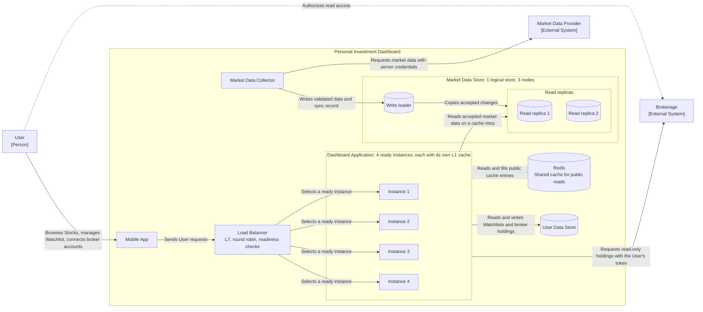
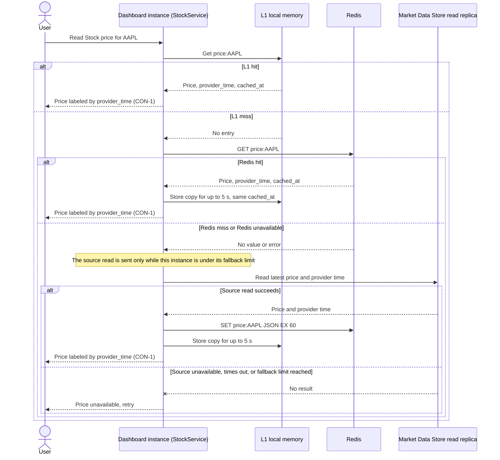
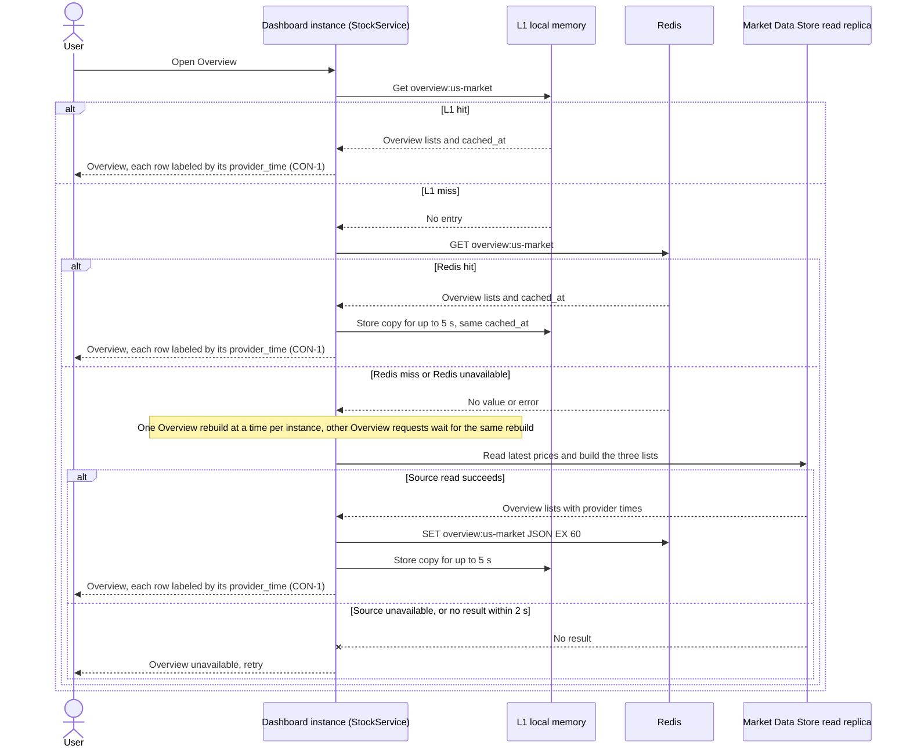

# Lab 4: Personal Investment Dashboard - Read Path Scaling

Scope: the 3,000-User Stock price read path from Lab 2, on the containers from Lab 3. The Lab 2 quality requirements and the Lab 3 flows stay the same. Section 2 lists every change to Lab 3.

---

## 1. Scale the service and route requests

### Dashboard instances

```text
buffered target = Stock price RPS x (1 + buffer)
                = 600 x 1.20 = 720 RPS

instances for normal load = ceil(720 / 250) = ceil(2.88) = 3

with 3 instances and one loss: 2 x 250 = 500 RPS  (below 720)
with 4 instances and one loss: 3 x 250 = 750 RPS  (meets 720)

minimum = 4 ready Dashboard instances
```

### Load balancer

| Decision | Choice |
| -------- | ------ |
| Layer | L7 (HTTP) |
| Selection method | Round robin over ready instances |
| Reason | Each Mobile App request is an independent HTTP request. Stock price requests have a similar service cost, so equal turns give equal load. An L7 load balancer routes each request separately, even when the Mobile App keeps one connection open. A stopped instance fails the readiness check, and the load balancer sends no more requests to that instance. |
| Main limit | Round robin does not measure the load on an instance. A slow instance, or an instance with heavier Overview and History reads, still receives every fourth request. |

### State and instance loss

| State | Location | If one Dashboard instance stops |
| ----- | -------- | ------------------------------- |
| User records that IdentityService uses to verify tokens | User Data Store | Another instance verifies the next request |
| Watchlists, broker connections, imported holdings | User Data Store | Another instance reads the confirmed value |
| Accepted prices, provider times, history, sync record | Market Data Store | Another instance reads the same accepted data |
| Shared public cache entries | Redis (not required state; the Dashboard Application rebuilds each entry from the Market Data Store) | Another instance reads the same entry |
| Parsed fields and verified User ID of the current request | Instance memory | The current request fails. The Mobile App shows "unavailable, retry" (Lab 2 LAT-3). The next request goes to another instance. |
| L1 cache copies of public reads | Instance memory | The copies are lost. The next read uses Redis or a read replica. |

No required state is only in one instance, so the Dashboard Application is stateless between requests.

---

## 2. Scale the Market Data Store

```text
read replicas = ceil(720 / 400) = ceil(1.8) = 2

Market Data Store = 1 write leader + 2 read replicas = 3 nodes
```

The write leader does not serve routine public reads, so the calculation does not count the write leader.



### Changes to Lab 3

| Lab 3 decision | Lab 4 change |
| -------------- | ------------ |
| The Mobile App calls the Dashboard Application directly ("nothing to route") | The Mobile App calls the Load Balancer. The Load Balancer selects one of 4 ready instances. |
| Every public read goes to the Market Data Store | A public read checks L1, then Redis. Only a miss in both layers reads the Market Data Store. |
| The Market Data Store is one node | The Market Data Store has 1 write leader and 2 read replicas. The Market Data Collector writes to the write leader. |
| No cache container | Redis is a new container: a shared cache for public reads. |

---

## 3. Cache two public reads

Overview is the US market overview: the top 10 gainers, the top 10 losers, and the 10 most active Stocks. Each User gets the same result. This definition is an assumption, because Lab 2 gives only the name of the read.

### Cache contracts

| Decision | Stock price | Overview |
| -------- | ----------- | -------- |
| Repeated work removed | 600 RPS request the same 11,152 latest prices. Each price changes at most one time per minute. A hit removes one read-replica query. | 70 steady RPS plus 90 RPS at market open request one identical result. A hit removes one scan and one sort of 11,152 latest prices. |
| Key | `price:{symbol}`, for example `price:AAPL` | `overview:us-market`. The only input is the market, and the Dashboard supports one market. |
| Value | `symbol`, `price`, `currency`, `provider_time`, `cached_at`. The value contains no label. The Dashboard Application calculates "Delayed," "At close," or "Price unavailable" at read time. | Three lists. Each row has `symbol`, `price`, `change_pct` or `volume`, and `provider_time`. The value has one `cached_at`. |
| Private User data | None. The key and the value contain no User ID, token, or Watchlist. | None |
| Source | Latest prices in the Market Data Store, read from a read replica | Latest prices and Stock reference data in the Market Data Store, read from a read replica |
| L1 lifetime | 5 s, and never later than `cached_at` + 60 s | 5 s, and never later than `cached_at` + 60 s |
| Freshness | Simple TTL. An entry is fresh while `now - cached_at <= 60 s` (one sync interval). The Dashboard Application does not use a stale entry. Redis expiry: `EX 60`. | Simple TTL. An entry is fresh while `now - cached_at <= 60 s`. The Dashboard Application does not use a stale entry. Redis expiry: `EX 60`. |
| Failure result | L1 entry lost: the instance reads Redis. Redis empty or unavailable: the instance reads a read replica, within the fallback limit. In these two cases the User sees the normal result. Read replica unavailable, or fallback limit reached: the User sees "Price unavailable, retry." The User never sees an old price as a replacement. | Same path as Stock price. Read replica unavailable, or fallback limit reached: the User sees "Overview unavailable, retry." |

`cached_at` is the time of the source read. The same `cached_at` goes with the copy into the two layers, so an L1 hit cannot extend the age of the data. On each result, from any layer, the Dashboard Application applies Lab 2 CON-1 to `provider_time`:

- up to 20 minutes: "Delayed, as of HH:MM ET"
- more than 20 minutes: "Price unavailable"
- outside market hours: "At close"

In Overview, the Dashboard Application applies the rule to each row. The cache adds at most 60 s to the 1-minute sync interval. This total stays in the 5-minute sync slack of CON-1.

### Sequence: Stock price



### Sequence: Overview



### Warmup and fallback

| Rule | Decision |
| ---- | -------- |
| When | 09:29:30 ET on each trading day, and after Redis restarts or recovers |
| Bounded keys | `overview:us-market`, and `price:{symbol}` for the 500 most-read Stocks of the previous trading day. The maximum is 501 keys. The number 500 is an assumption; measured read counts must replace this number. |
| How | One batched read-replica query gets the 500 prices, and one query gets the Overview. The warmup writes the results to Redis with `EX 60`. The warmup does not fill L1. Each instance fills L1 on the first read. |
| Fallback limit, Stock price | Each Dashboard instance sends at most 200 source reads per second. 4 x 200 = 800 RPS. This value equals the capacity of the 2 read replicas (2 x 400 = 800 RPS) and is more than the 720 RPS target. |
| Fallback limit, Overview | Each Dashboard instance runs one rebuild at a time. |

The Redis expiry is 60 s, so the keys from the 09:29:30 warmup stay until 09:30:30 ET. This interval contains the 10-second market-open burst from Lab 2. After this interval, normal reads fill the keys again.

When the warmup is incomplete, a key that the warmup did not fill is an ordinary miss. Below the fallback limit, the User sees the normal labeled result from a read replica. At the fallback limit, the User sees "Price unavailable, retry" or "Overview unavailable, retry," and the User decides when to retry. The User never sees an old price or a price without a label.

---

## 4. Redis cache path with commands

### Stock price

Stored JSON value:

```json
{"symbol":"AAPL","price":229.35,"currency":"USD","provider_time":"2026-11-10T15:00:00Z","cached_at":"2026-11-10T15:15:20Z"}
```

```text
127.0.0.1:6379> GET price:AAPL
(nil)
127.0.0.1:6379> SET price:AAPL '{"symbol":"AAPL","price":229.35,"currency":"USD","provider_time":"2026-11-10T15:00:00Z","cached_at":"2026-11-10T15:15:20Z"}' EX 60
OK
127.0.0.1:6379> GET price:AAPL
"{\"symbol\":\"AAPL\",\"price\":229.35,\"currency\":\"USD\",\"provider_time\":\"2026-11-10T15:00:00Z\",\"cached_at\":\"2026-11-10T15:15:20Z\"}"
127.0.0.1:6379> TTL price:AAPL
(integer) 57
```

Between the first `GET` and the `SET`, the Dashboard instance reads the latest price and provider time from a read replica. The Stock price sequence shows this read.

### Overview

Stored JSON value. The sample shows one row for each list; the real value has 10 rows for each list.

```json
{"market":"US","gainers":[{"symbol":"NVDA","price":141.20,"change_pct":4.1,"provider_time":"2026-11-10T15:00:00Z"}],"losers":[{"symbol":"INTC","price":22.40,"change_pct":-3.2,"provider_time":"2026-11-10T15:00:00Z"}],"most_active":[{"symbol":"AAPL","price":229.35,"volume":18400000,"provider_time":"2026-11-10T15:00:00Z"}],"cached_at":"2026-11-10T15:15:21Z"}
```

```text
127.0.0.1:6379> GET overview:us-market
(nil)
127.0.0.1:6379> SET overview:us-market '{"market":"US","gainers":[{"symbol":"NVDA","price":141.20,"change_pct":4.1,"provider_time":"2026-11-10T15:00:00Z"}],"losers":[{"symbol":"INTC","price":22.40,"change_pct":-3.2,"provider_time":"2026-11-10T15:00:00Z"}],"most_active":[{"symbol":"AAPL","price":229.35,"volume":18400000,"provider_time":"2026-11-10T15:00:00Z"}],"cached_at":"2026-11-10T15:15:21Z"}' EX 60
OK
127.0.0.1:6379> GET overview:us-market
"{\"market\":\"US\",\"gainers\":[{\"symbol\":\"NVDA\",\"price\":141.20,\"change_pct\":4.1,\"provider_time\":\"2026-11-10T15:00:00Z\"}],\"losers\":[{\"symbol\":\"INTC\",\"price\":22.40,\"change_pct\":-3.2,\"provider_time\":\"2026-11-10T15:00:00Z\"}],\"most_active\":[{\"symbol\":\"AAPL\",\"price\":229.35,\"volume\":18400000,\"provider_time\":\"2026-11-10T15:00:00Z\"}],\"cached_at\":\"2026-11-10T15:15:21Z\"}"
127.0.0.1:6379> TTL overview:us-market
(integer) 57
```

Between the first `GET` and the `SET`, the Dashboard instance reads the latest prices from a read replica and builds the three lists. The Overview sequence shows this read.

### Why a Redis TTL does not prove freshness

The TTL counts the seconds from the `SET` command. The TTL does not measure the age of the source data. In the Stock price value, `provider_time` is 15:00:00 and `cached_at` is 15:15:20. At the `TTL` command, the copy is 3 seconds old in Redis (60 - 57 = 3), but the price is 15 minutes 23 seconds old.

If the sync stops, Redis can store a price with a 19-minute-old `provider_time` and a full 60 s TTL. This price then passes the 20-minute limit while the key still exists. Thus the Dashboard Application compares `provider_time` with the read time on each result. `cached_at` limits only the time that an instance can use a copy.

### Persistence

Redis uses no disk persistence (no RDB, no AOF). The Dashboard Application can rebuild each entry from the Market Data Store, and each entry stays for a maximum of 60 s. Thus a restored snapshot contains only expired entries.

After a restart, Redis is empty and each `GET` is a miss. The Dashboard instances read the read replicas within the fallback limit, and the warmup runs again. Until the keys are full again, requests above the fallback limit get "Price unavailable, retry" or "Overview unavailable, retry."
